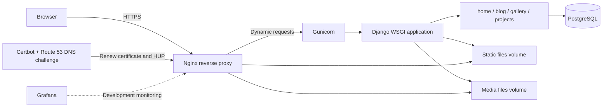

# Unlucky Strike

Unlucky Strike is a Django-based technology blog and personal project
showcase. It combines long-form blog posts, image galleries, project pages,
ETF/dividend data, and static informational pages in one server-rendered web
application.

## Contents

- [Features](#features)
- [Architecture](#architecture)
- [Technology stack](#technology-stack)
- [Repository structure](#repository-structure)
- [Development setup](#development-setup)
- [Production deployment](#production-deployment)
- [Configuration](#configuration)
- [Operations](#operations)
- [Testing and maintenance](#testing-and-maintenance)
- [Security notes](#security-notes)

## Features

- **Home**: Static pages such as About and Contact.
- **Blog**: Categorized posts, rich-text editing, file uploads, comments, and
  draft/published states.
- **Gallery**: Galleries, ordered photos, tags, likes, and comments.
- **Projects**: Project pages and ETF, dividend, and currency data.
- **Administration**: Django Admin for managing users and application data.
- **SEO and API documentation**: Sitemap, `robots.txt`, `ads.txt`, Swagger UI,
  and ReDoc.
- **Observability**: Grafana is available in the development Compose stack.
- **Production delivery**: Docker Compose, Nginx, Gunicorn, PostgreSQL, and
  Let's Encrypt certificates issued through the AWS Route 53 DNS challenge.

## Architecture

### Logical architecture



### Runtime flow

1. Nginx terminates TLS and redirects HTTP traffic to HTTPS.
2. Nginx serves `/static/` and `/media/` directly from shared Docker volumes.
3. Other requests are proxied to the `web` container on port `8000`.
4. Gunicorn loads `main.wsgi:application` and runs the Django application.
5. Django dispatches requests from `main.urls` to the `home`, `blog`,
   `gallery`, or `projects` application.
6. Django reads and writes application data through the configured database
   backend. Production Compose uses PostgreSQL; local fallback settings use
   SQLite when no database environment variables are supplied.
7. Certbot renews certificates every 12 hours. After a successful renewal it
   sends `SIGHUP` to Nginx so the new certificate is loaded without restarting
   the proxy.

The application is a server-rendered Django monolith. The domain apps own
their models, views, templates, URL configuration, migrations, and tests;
`main` provides shared settings, root routing, WSGI/ASGI entry points,
context processors, and sitemap configuration.

## Technology stack

| Layer | Technology |
| --- | --- |
| Application | Python, Django, Django REST Framework |
| Content editing and media | django-ckeditor, Pillow |
| Data and integrations | PostgreSQL, SQLite fallback, Requests, yfinance |
| Application server | Gunicorn |
| Reverse proxy and TLS | Nginx, Certbot, AWS Route 53 DNS challenge |
| Containers | Docker and Docker Compose |
| Monitoring | Grafana (development Compose profile) |
| Frontend | Django templates, CSS, Bootstrap-compatible styling |

## Repository structure

```text
.
├── images/                       # Project screenshots and branding
├── src/
│   ├── Dockerfile                # ARM32v7 Python application image
│   ├── docker-compose.dev.yml    # Local web, PostgreSQL, and Grafana stack
│   ├── docker-compose.yml        # Production web, PostgreSQL, Nginx, Certbot
│   ├── nginx/                    # Nginx image and reverse-proxy configuration
│   ├── certbot/                  # Certbot image with Route 53 plugin
│   ├── requirements.txt          # Python dependencies
│   ├── backup.sh                 # Blog fixture export
│   ├── download.sh               # Local dependency installation helper
│   └── unluckystrike/
│       ├── manage.py              # Django management entry point
│       ├── main/                  # Project settings, root URLs, WSGI/ASGI
│       ├── home/                  # Static pages
│       ├── blog/                  # Blog domain
│       ├── gallery/                # Gallery and photo domain
│       ├── projects/               # Project and financial-data domain
│       ├── config/                 # Legacy uWSGI/Nginx service configuration
│       └── .static/, .media/       # Collected static and uploaded media files
└── data/                          # Local certificate and persistent data mounts
```

## Development setup

### Prerequisites

- Docker and Docker Compose
- Git
- An ARM32v7-compatible Docker runtime for the repository's default
  application image, or a locally adjusted Dockerfile for another platform

### Run the development stack

From the repository root:

```sh
cd src
docker compose -f docker-compose.dev.yml up --build
```

The services are available at:

- Django: <http://localhost:8000>
- PostgreSQL: `localhost:5432`
- Grafana: <http://localhost:3000>

The development Compose file mounts the source tree into the `web` container.
Restart the `web` service after changes if the running Gunicorn process does
not reload them automatically.
Stop the stack with `Ctrl-C`, or run `docker compose -f docker-compose.dev.yml
down`. Add `-v` only when intentionally deleting local database and Grafana
volumes.

### Run Django commands

```sh
cd src
docker compose -f docker-compose.dev.yml exec web \
  python ./unluckystrike/manage.py migrate
docker compose -f docker-compose.dev.yml exec web \
  python ./unluckystrike/manage.py createsuperuser
docker compose -f docker-compose.dev.yml exec web \
  python ./unluckystrike/manage.py collectstatic --noinput
```

Open the admin site at <http://localhost:8000/admin/>.

## Production deployment

The production stack is defined in `src/docker-compose.yml` and consists of:

- `web`: Django served by Gunicorn on internal port `8000`
- `db`: PostgreSQL 14.2 with a named persistent volume
- `nginx`: public ports `80` and `443`, TLS termination, and static/media
  delivery
- `certbot`: certificate renewal using the Route 53 DNS plugin

### Configure environment files

Create the files referenced by the production Compose file. They are
environment-specific and must not be committed:

- `src/unluckystrike/.env.prod`
- `src/unluckystrike/.env.prod.db`
- `src/unluckystrike/.env.route53`

At minimum, configure a strong `SECRET_KEY`, `DEBUG=0`, the production
`DJANGO_ALLOWED_HOSTS`, database connection variables, and the Route 53
credentials required by the DNS plugin. Restrict the IAM policy to the
necessary hosted zone operations (`ListHostedZones`, `GetChange`, and
`ChangeResourceRecordSets`).

### Issue the first certificate and start the stack

Before Nginx starts, issue the initial certificate. Replace the example email
and domain values with the values configured in `src/nginx/nginx.conf`.

```sh
cd src
cp unluckystrike/.env.route53.example unluckystrike/.env.route53
docker compose build certbot
docker compose run --rm --no-deps certbot certonly \
  --dns-route53 \
  --email admin@example.com \
  --agree-tos \
  --no-eff-email \
  --non-interactive \
  -d unluckystrike.com \
  -d www.unluckystrike.com
docker compose up -d --build
```

The certificate files are stored under `data/certbot/conf`. The Nginx
configuration must use the same domain names as the certificate.

To validate renewal without replacing the live certificate:

```sh
docker compose run --rm --no-deps certbot renew --dry-run
```

## Configuration

`src/unluckystrike/main/settings.py` reads the following important variables:

| Variable | Purpose |
| --- | --- |
| `SECRET_KEY` | Django cryptographic signing key |
| `DEBUG` | Enables/disables Django debug mode |
| `DJANGO_ALLOWED_HOSTS` | Space-separated allowed host names |
| `SQL_ENGINE` | Django database backend |
| `SQL_DATABASE` | Database name or SQLite file path |
| `SQL_USER` / `SQL_PASSWORD` | Database credentials |
| `SQL_HOST` / `SQL_PORT` | Database network location |

Static files are collected into `.static` and uploaded files are stored in
`.media`. In production, both directories are shared between the `web` and
`nginx` containers through named volumes.

## Operations

### Back up blog data

Run the included helper from `src` while the production stack is running:

```sh
cd src
sh backup.sh
```

This exports the `blog` application data to `src/db_backup.json`. Treat the
result as application data and protect it accordingly.

### Logs and service status

```sh
cd src
docker compose ps
docker compose logs -f web
docker compose logs -f nginx
```

Use `docker compose exec web python ./unluckystrike/manage.py check
--deploy` before a production release to identify deployment configuration
issues.

## Testing and maintenance

Run the Django test suite in the development container:

```sh
cd src
docker compose -f docker-compose.dev.yml exec web \
  python ./unluckystrike/manage.py test
```

Apply migrations after model changes:

```sh
docker compose -f docker-compose.dev.yml exec web \
  python ./unluckystrike/manage.py makemigrations
docker compose -f docker-compose.dev.yml exec web \
  python ./unluckystrike/manage.py migrate
```

Do not delete existing migrations or the database as part of normal
development. The `src/unluckystrike/init.sh` script is a destructive
re-initialization helper and should only be used when intentionally rebuilding
a local database.

## Security notes

- Never commit production environment files, private keys, database
  credentials, or Route 53 credentials.
- Keep `DEBUG=0` in production and set an explicit allow-list of hosts.
- The Certbot container mounts `/var/run/docker.sock` so it can signal Nginx.
  Docker socket access is equivalent to broad control over the Docker host;
  run this deployment only on a trusted host.
- Use a least-privilege IAM policy scoped to the required Route 53 hosted zone.
- Protect PostgreSQL and Grafana from public exposure with firewall rules.
- Review uploaded media and backup files as sensitive application data.

## License

This project is distributed under the terms of the [MIT License](LICENSE).
